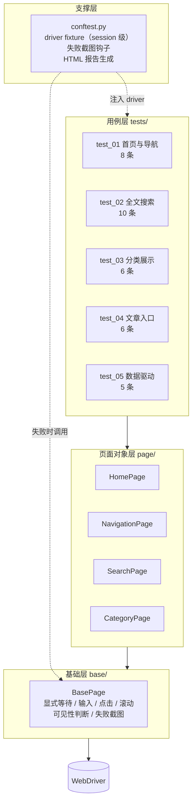

# 洞见微信 Web 自动化测试框架

> 基于 **pytest + Selenium + Page Object** 搭建的 Web UI 自动化测试框架，针对安全资讯平台
> 「洞见微信」的首页、导航、全文搜索、内容分类、文章入口五大模块。手工设计 **30 条用例，真实执行 30/30 通过**；另新增 **5 条参数化数据驱动用例** 作为后续扩展。

[](https://github.com/lyhua1435-cmd/doonsec-web-auto-test/actions/workflows/ci.yml)


---

## 目录

- [这个项目解决什么问题](#这个项目解决什么问题)
- [被测对象](#被测对象)
- [技术栈](#技术栈)
- [框架架构](#框架架构)
- [目录结构](#目录结构)
- [五个设计要点](#五个设计要点)
- [用例覆盖](#用例覆盖)
- [快速开始](#快速开始)
- [测试结果](#测试结果)
- [用例设计方法](#用例设计方法)
- [已知限制](#已知限制)

---

## 这个项目解决什么问题

被测站点是一个真实上线的第三方站点（70 万+ 安全文章全文检索），**没有测试环境、
没有接口文档、没有测试账号**。原始需求是"写几个脚本点点看"，但脚本式写法有三个
绕不过去的坑：

| 脚本式写法的问题 | 本框架的解法 |
|---|---|
| 元素定位散落在脚本里，站点一改版就要全局搜索修改 | 定位器全部收敛到 Page 层的类属性，改版只改一处 |
| `time.sleep(3)` 一把梭，快的用例白等、慢的用例还是失败 | 全部替换为 `WebDriverWait` 显式等待，按条件等待而非按时长等待 |
| 每次跑都重开浏览器，慢且容易触发风控 | session 级 fixture，整轮复用同一个浏览器会话 |
| 失败了只有一行 assert 报错，无法判断是环境问题还是功能问题 | 失败自动截图 + 记录 URL，报告里可直接查看现场 |
| 新增一个输入场景要复制一整个函数 | `@pytest.mark.parametrize` 数据驱动，加一行数据等于加一条用例 |

**一句话**：这个仓库的重点不是"能跑通 30 条用例"，而是把一份能跑通的脚本，
重构成为**可维护、可扩展、可追溯**的测试框架。

---

## 被测对象

| 项 | 内容 |
|---|---|
| 系统 | 洞见微信 · 安全圈微信公众号文章搜索平台 |
| 地址 | https://wechat.doonsec.com/ |
| 业务价值 | 安全从业者按关键词（CVE 编号、漏洞名称、攻击手法）检索 70 万+ 公众号文章 |
| 测试难点 | ① 需微信扫码鉴权，自动化登录不可行；② 导航存在 JS 绑定点击、偶发不跳转；③ 站点无测试环境，用例必须可在生产上安全重复执行 |

被测模块与主链路：

```
进入首页 → 顶部导航（公众号 / 高级搜索）→ 全文搜索 → 输入关键词 → 提交 → 结果页
                     ↓
              首页内容分类（最新 / 分类列表）→ 文章入口
```

---

## 技术栈

| 层 | 选型 | 说明 |
|---|---|---|
| 测试框架 | pytest 8/9 | fixture 管理、参数化、钩子扩展 |
| 浏览器驱动 | Selenium 4 | Selenium Manager 自动匹配驱动，免手装 chromedriver |
| 设计模式 | Page Object（PO） | 页面元素与操作封装，用例与页面解耦 |
| 报告 | 自研 HTML 报告 | 通过 `pytest_sessionfinish` 钩子生成，零第三方依赖 |
| CI | GitHub Actions | 框架健康度校验（编译 + 用例收集） |

---

## 框架架构



**分层职责边界（重要）**：

- **用例层**只允许出现 `页面对象方法调用 + assert`。一旦用例里出现等待、重试、
  元素查找、`if` 分支，说明抽象漏到了错误的层。
- **页面对象层**负责"业务动作"语义（`search_keyword`、`click_es_nav`），
  并吸收页面自身的不稳定性（如 href 兜底跳转）。
- **基础层**只做通用 Selenium 操作，不知道任何具体业务。

---

## 目录结构

```
doonsec-web-auto-test/
├── README.md
├── pytest.ini                    # 用例路径、命名规则、标记注册
├── conftest.py                   # driver fixture / 失败截图 / HTML 报告
├── requirements.txt
│
├── base/
│   └── base_page.py              # 基础层：通用操作封装
│
├── page/                         # 页面对象层（4 个页面）
│   ├── home_page.py
│   ├── navigation_page.py
│   ├── search_page.py
│   └── category_page.py
│
├── tests/                        # 用例层（35 条）
│   ├── test_01_home_navigation.py
│   ├── test_02_full_text_search.py
│   ├── test_03_category_display.py
│   ├── test_04_account_article_entries.py
│   └── test_05_keyword_data_driven.py
│
├── testcases/
│   └── 自动化测试用例.csv         # 30 条用例明细（编号/前置/步骤/预期/优先级）
│
├── docs/
│   ├── 测试用例设计说明.md        # 设计方法论：等价类、边界值、场景法、错误推测
│   └── 测试报告.md               # 执行结果与遗留问题
│
├── reports/
│   └── report.html              # 真实执行生成的测试报告
│
└── .github/workflows/ci.yml
```

---

## 五个设计要点

### 1. 元素定位器收敛为类属性

```python
class HomePage(BasePage):
    logo_img    = (By.CSS_SELECTOR, ".logo img")
    search_icon = (By.CLASS_NAME, "search_pic")
    all_links   = (By.TAG_NAME, "a")
```

站点改版时，只改这一个文件；用例层完全不受影响。
本框架**有意覆盖了 5 种定位方式**（CSS / CLASS_NAME / NAME / LINK_TEXT /
PARTIAL_LINK_TEXT / XPATH / TAG_NAME），每种都对应明确的使用场景，详见
[用例设计说明 · 第 4 节](docs/测试用例设计说明.md#4-元素定位策略)。

### 2. 显式等待取代固定休眠

```python
def wait_visible(self, locator, timeout=None):
    return WebDriverWait(self.driver, timeout or self.timeout).until(
        EC.visibility_of_element_located(locator)
    )

def wait_clickable(self, locator, timeout=None):
    """可点击 = 可见 + 未被遮挡 + 未 disabled，比 visible 更严格"""
    return WebDriverWait(self.driver, timeout or self.timeout).until(
        EC.element_to_be_clickable(locator)
    )
```

`wait_visible` 用于断言渲染，`wait_clickable` 用于真要点击的元素——
这两个语义混用是 UI 自动化最常见的隐性 bug 来源。

### 3. session 级 fixture 复用浏览器

```python
@pytest.fixture(scope="session")
def driver(request):
    ...
    yield drv
    drv.quit()
```

30 条用例只开一次浏览器：整轮从"开 30 次浏览器"降到"开 1 次"，
既省时间，也避免高频启动触发站点风控。

### 4. 不稳定逻辑锁在 Page 层（href 兜底）

```python
def click_es_nav(self) -> str:
    es = self.get_es_nav()
    href = es.get_attribute("href") or ""
    es.click()
    if href.startswith("http") and "/es" not in self.current_url:
        self.driver.get(href)      # 点击未跳转时兜底直达
    return href
```

导航是 JS 绑定点击、偶发不跳转。如果把这个判断写进用例，用例就变成了
"带分支的用例"，可信度立刻下降。放在 Page 层，用例依旧是干净的
`nav.click_es_nav(); assert "/es" in driver.current_url`。

### 5. 失败自动留证

```python
if report.failed:
    driver = item.funcargs.get("driver")
    screenshot = screenshot_on_failure(driver, item.name)
```

报告从"哪条挂了"升级为"哪条挂了 + 长什么样 + 在哪个 URL 挂的"，
排查时间从"重跑复现"变成"看截图"。

---

## 用例覆盖

### 模块汇总

| 模块 | 用例数 | 覆盖重点 | 用例编号 |
|---|---:|---|---|
| 首页与导航 | 8 | 站点可达、标题、Logo、搜索入口、公众号/高级搜索导航、链接属性、页面跳转 | 001 ~ 008 |
| 全文搜索 | 10 | 输入框属性、关键词输入回填、按钮状态、提交搜索、关键词二次编辑 | 009 ~ 018 |
| 分类展示 | 6 | 「最新」分类展示/文本/点击、分类列表、**点击后结构未塌陷（历史缺陷回归）** | 019 ~ 024 |
| 公众号与文章入口 | 6 | 入口 href 有效性、点击后站点归属、页面关键字、文章链接数量与格式 | 025 ~ 030 |
| 数据驱动补充 | 5 | CVE / 漏洞复现 / POC / SQL注入 / 弱口令 五组关键词矩阵 | 031 ~ 035 |

用例明细（前置条件、测试步骤、预期结果、优先级、对应 pytest 函数）见
[`testcases/自动化测试用例.csv`](testcases/自动化测试用例.csv)。

### 用例类型分布

| 类型 | 数量 | 说明 |
|---|---:|---|
| 正常路径 | 24 | 主流程正向验证 |
| 界面渲染 | 6 | 元素可见性与属性校验 |
| 异常兼容 / 回归 | 2 | 针对历史缺陷的回归保护 |
| 数据驱动 | 5 | 参数化批量覆盖输入矩阵 |

---

## 快速开始

```bash
# 1. 安装依赖
pip install -r requirements.txt

# 2. 全量执行（首次需在浏览器中微信扫码解锁）
pytest --pause-login

# 3. 只看冒烟用例
pytest -m smoke --pause-login

# 4. 无头模式（本地快速回归，不含扫码环节）
pytest --headless

# 5. 答辩/演示模式：每条用例后停留 2 秒便于观察
pytest --pause-login --slow 2

# 6. 只跑某个模块
pytest tests/test_02_full_text_search.py --pause-login
```

执行完成后自动生成 `reports/report.html`。

### 自定义命令行参数

| 参数 | 作用 |
|---|---|
| `--pause-login` | 打开浏览器后暂停，等待人工扫码解锁后回车继续 |
| `--headless` | 无头模式，不弹窗口 |
| `--slow <秒>` | 每条用例结束后额外等待，用于演示 |

---

## 测试结果

> 完整报告：[`reports/report.html`](reports/report.html)（由框架自动生成）

| 指标 | 数值 |
|---|---|
| 已执行用例 | 30（手工设计，覆盖 4 个模块） |
| 通过 | 30 |
| 失败 | 0 |
| 通过率 | **100%** |
| 用例执行累计耗时 | ≈ 32.5 s |
| 新增待回归 | 5 条参数化用例（已验证可被正常收集，待下次扫码执行） |

> 说明：30 条为课程阶段在真实站点上的执行记录（见 `reports/report.html`）。
> 第 5 个文件里的 5 条参数化用例是本次重构新增的，只验证过「能被 pytest 正确收集」，
> **尚未在站点上执行**，因此不计入通过率。

耗时分布佐证了显式等待确实生效：涉及「点击 + 页面跳转」的用例集中在 1.5~2.3 s，
纯元素可见性校验在 0.3 s 左右，差异来自真实渲染而非固定 sleep 的均匀浪费。

---

## 用例设计方法

这个仓库不只交付用例，也交付**用例是怎么想出来的**。详见
[`docs/测试用例设计说明.md`](docs/测试用例设计说明.md)：

- **等价类划分**：把关键词输入划成英文缩写 / 中文短语 / 中英混合 / 空输入四类
- **边界值分析**：断言 `links > 5` 而非 `== N`——精确数量会随内容更新失效，
  这里守护的是"结构未塌陷"这个业务不变量
- **场景法**：`首页 → 高级搜索 → /es → 输入 CVE → 提交 → 结果页` 串成完整用户路径
- **错误推测法**：从"这里最容易坏"反推用例（二次输入未清空、中文乱码、点击不跳转）
- **参数化**：把复制粘贴的 5 个函数改成 1 个函数 + 5 行数据

---

## 已知限制

诚实说明当前框架的边界，也说明下一阶段要做什么：

| 限制 | 原因 | 后续方案 |
|---|---|---|
| 无法无人值守全量执行 | 站点需微信扫码鉴权 | 申请测试账号 / 推动提供免登录测试环境 |
| CI 只做框架健康度校验 | 同上 | 用 Docker + 固定登录态打通全量回归 |
| 搜索结果未校验相关性 | 缺接口文档与断言规则 | 下沉到接口层断言，或建立结果标题匹配规则 |
| 未做多浏览器/响应式 | 时间与设备限制 | 接入 Selenium Grid 覆盖 Chrome/Firefox/Edge |

---

## License

MIT
